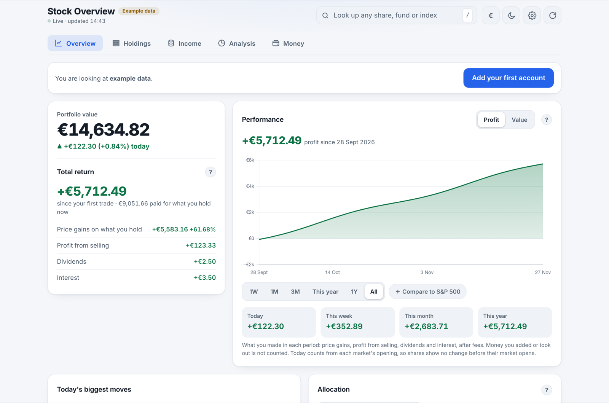
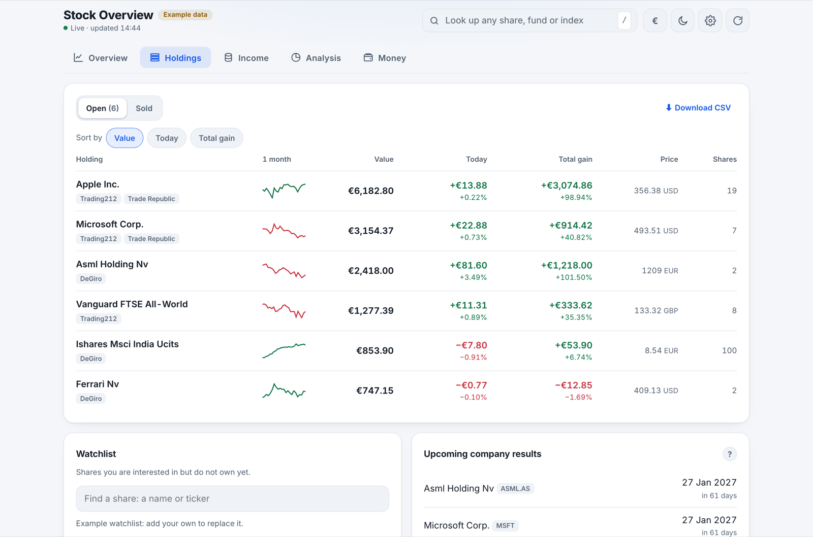
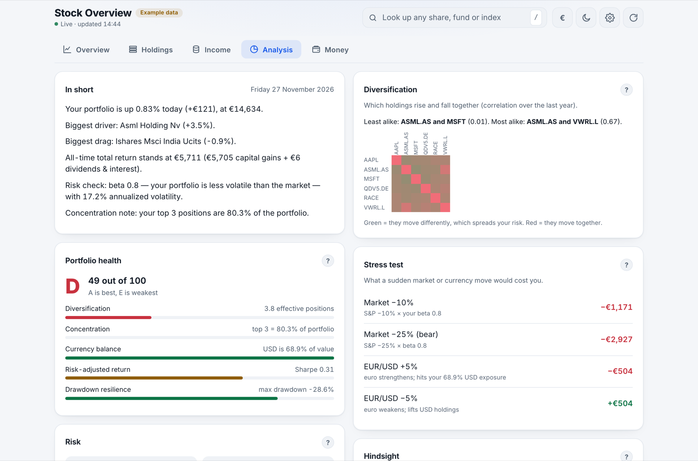
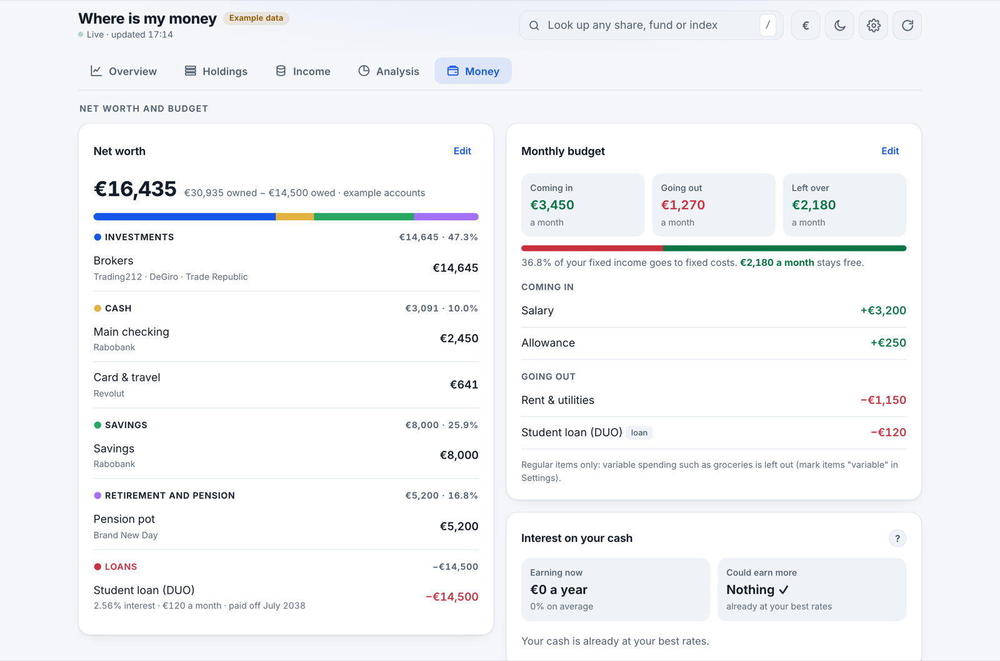
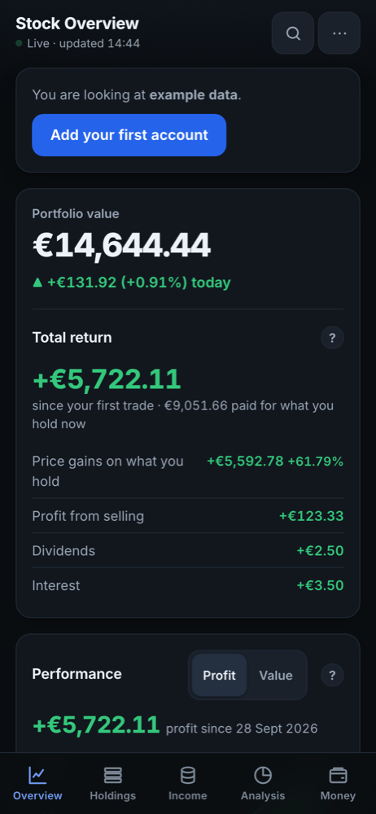

# 📈 Where is my money (Wimm)


All your investments in one place: every broker, your cash, and what it all
earns you. Open source, and it runs on your own computer.

- **Your data stays with you.** It lives in one folder on your computer.
  There is no account to create and no company server.
- **Read-only.** The app can look, never trade or move money.
- **Ask Claude.** Connect Claude and ask "how did my portfolio do this month?"



| Holdings | Analysis |
|---|---|
|  |  |
| **Money** | **On a phone, in dark mode** |
|  |  |

All screenshots show the example data the app starts with.

## Start

You need [Python 3.10+](https://www.python.org/downloads/) and Git.

```bash
git clone https://github.com/GidonPeeper/Where-is-my-money.git
cd Where-is-my-money
./run.sh            # Windows: double-click run.bat
```

Your browser opens http://127.0.0.1:8000 with sample data. Add your first
account in **Settings** and the samples disappear. Full guide:
[SETUP.md](SETUP.md). Update later with `./run.sh update`. Something not
working? [TROUBLESHOOTING.md](TROUBLESHOOTING.md).

## What you get

| Tab | What it shows |
|---|---|
| **Overview** | Portfolio value, today's change, total return split into price gains, profit from selling, dividends, interest and fees. A performance chart (1W to all time) you can compare with the S&P 500. Biggest moves and allocation |
| **Holdings** | Every position, merged across brokers by ISIN. Sold positions, watchlist, upcoming company results |
| **Income** | Dividends and interest received per year, and what to expect in the next 12 months |
| **Analysis** | A plain-language summary, a health score, risk figures with an explanation, diversification, a stress test and a 10-year projector |
| **Money** | Net worth (investments, cash, things you own, loans), monthly budget, ways to save, how tax on investments works in your country, UK tax-year figures, and tax-loss checks for the UK, US and NL |

On every tab, the search at the top looks up the price of any share, fund,
index, currency or crypto by name, ticker or ISIN: today's change, a chart,
key facts and what you hold of it. A link like `/#lookup=NVDA` opens it.

Opening a holding or a looked-up share also shows its key numbers for your own
analysis: P/E, forward P/E, EV/EBITDA, revenue, EBITDA, margins, return on
equity, growth, debt, cash, free cash flow, dividend yield and beta (for a fund:
yearly cost, returns and what it holds). Each has a ? that explains the number
in plain words.

## Make it yours

Choose these in **Settings**; they are saved with your data.

- **Your country.** 23 countries have a page on how tax on investments works
  there (gains, dividends, interest, funds, tax-free accounts, losses, what to
  report), each figure taken from the tax authority's own site with the date
  it was checked, plus news feeds in the local language. General
  information, not advice. The app's own tax calculations cover the UK, the
  US and the Netherlands.
- **Currency.** Amounts in euros, pounds or dollars.
- **Colours.** A base and a secondary colour, in light or dark. Whatever you
  pick is adjusted so text stays readable.

It also installs on a phone as an app.

## Brokers and banks

Pick yours from a list of about 50 in **Settings → Add an account**. The app
shows the simplest way that works, with numbered steps.

| Way | Works for | What it reads |
|---|---|---|
| Read-only key | Trading 212, Interactive Brokers, eToro, Bitvavo, Starling, Wise | Positions, trades, dividends, cash |
| Statement file | DEGIRO, Trade Republic, Trading 212 | Full history, checked against the statement's own totals |
| Sign-in | Trade Republic (unofficial, see below) | Positions, cash, history |
| Bank link | EU banks through Enable Banking (free for personal use) | Balances |
| Positions file | Any other broker (CSV) | Positions |
| Typed balance | Any bank, savings or pension account | Balance |

The steps for each broker were checked against the broker's own help pages on
26 November 2026. Steps that could not be confirmed are marked in the app.

**Trade Republic sign-in.** Trade Republic has no public API. The app can sign
in the way Trade Republic's own website does: phone number and PIN, then you
approve in the Trade Republic app. Your PIN is sent to Trade Republic once and
never stored. This route is unofficial: it can stop working when Trade
Republic changes its app, and it may be against their terms. The transaction
export file is the official route and stays the default.

## Ask Claude

Wimm is an MCP server, so Claude can answer questions from your own
numbers: performance, holdings, dividends, net worth, risk and tax figures.
Claude gets twelve read-only tools and nothing else, among them the price of
any share and the tax overview for your country.

```bash
./run.sh claude     # prints the command to connect Claude Code or Claude Desktop
```

Details and privacy notes: [MCP.md](MCP.md).

## Your data and safety

- Everything you add is saved in the `data` folder, which git ignores. Back
  it up with **Settings → Download a backup**, and keep that file private.
  How to back up, update, move or start over:
  [SETUP.md](SETUP.md#5-back-up-update-move-or-start-over).
- **Check-up.** Settings → App and data → Check-up says when something needs
  attention and what to do: a refused key, an old statement, no recent
  backup, tax rules for a past year, a newer version.
- Broker keys must be read-only: the steps say which boxes to tick. Keys are
  never sent back to the browser.
- Without a password the app answers only your own computer. To use it from
  your phone or the internet, set a password first ([SETUP.md](SETUP.md)).
- Prices come from Yahoo Finance and news from public news sites. The app
  asks them only for prices and headlines: your amounts and files stay on
  your computer. No AI service is needed; Claude is optional. Tax figures are
  estimates, not advice.

## Use it away from home (optional)

Run your own copy online for free on Render, with your data encrypted in a
private GitHub repository of your own: see [SETUP.md](SETUP.md) and
[DEPLOY_RENDER.md](DEPLOY_RENDER.md). A tunnel to your own computer also
works: [HOSTING.md](HOSTING.md).

## For developers

FastAPI backend, plain JavaScript frontend with Chart.js (no build step),
prices from yfinance.

```bash
.venv/bin/python -m unittest discover -s tests -t .    # no network or keys needed
```

| Where | What |
|---|---|
| `backend/connectors/` | One file per broker or bank; `registry.py` links them to the list |
| `backend/broker_catalog.json` | The list of institutions and their steps (data, not code) |
| `backend/importers/` | Statement files (PDF, CSV) to the app's own format |
| `backend/positions.py`, `realized.py`, `trend.py` | Cost basis, realized profit, and the daily history rebuilt from trades |
| `backend/mcp_server.py`, `mcp_tools.py` | The Claude connector |
| `backend/countries/` | One file per country: the tax overview and news feeds (data, see `SCHEMA.md` there) |
| `backend/lookup.py` | The price lookup |
| `backend/keynumbers.py` | Key numbers of a share or fund (P/E, EBITDA, margins...) |
| `backend/prefs.py` | Choices made in Settings: country, currency, time zone, colours |
| `frontend/` | The dashboard and Settings pages |

Statement files can also be converted from the command line, for example
`python -m backend.importers.degiro_pdf "Account.pdf" data/degiro_account.csv`.

Want to add a broker or fix a step? See [CONTRIBUTING.md](CONTRIBUTING.md).
Keeping the app right over the years (UK tax year, country pages, broker
steps, dependencies, releases): [MAINTAINING.md](MAINTAINING.md).

## License

[AGPL-3.0](LICENSE). You can use, change and run it for free, for
yourself or for others. If you run a changed version for other people over
the internet, you must offer them your changed code under the same licence.

Credits: the Trade Republic sign-in follows the protocol used by
[pytr](https://github.com/pytr-org/pytr) (MIT). Chart.js (MIT) and the Inter
font (SIL Open Font License) are included in `frontend/vendor/` with their
licences.
