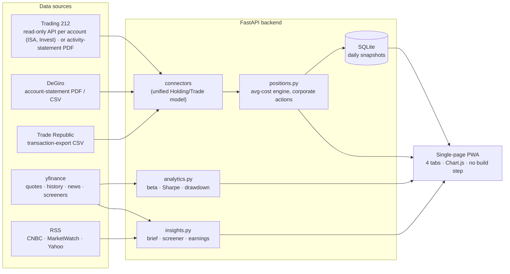

# 📈 Stock Overview


A self-hosted, mobile-first dashboard that **unifies your stock portfolio across
multiple brokers** — Trading 212 (Invest and Stocks ISA), DeGiro and Trade
Republic — into one live app: merged positions, exact profit accounting, a UK
tax-year view, quant analytics, a daily market brief, and a transparent
small-cap screener. Shows amounts in pounds or euros.

**Read-only by design: it can never place a trade or move money.**

**Want your own?** [SETUP.md](SETUP.md) gets you your own private copy online in
about 20 minutes, free.

## ⚡ Try it in 60 seconds (demo mode)

```bash
git clone https://github.com/GidonPeeper/stock-overview.git && cd stock-overview
python3 -m venv .venv && .venv/bin/pip install -r requirements.txt
.venv/bin/uvicorn backend.main:app
# → open http://127.0.0.1:8000  — bundled sample data, no keys needed
```

## ✨ Features

| | |
|---|---|
| 🔀 **Merged holdings** | The same company held at several brokers or accounts becomes one position (matched by ISIN) |
| 🇬🇧 **UK tax year** | Gains and dividends outside your ISA since 6 April, CGT and dividend allowance left, ISA allowance used, and a 30-day ("bed and breakfast") reminder after each sale |
| 🌾 **Tax-loss harvesting** | Positions outside your ISA that are down enough to sell for a tax loss: tax saved this year (using this year's gains and the £3,000 allowance), the day you can buy back, and swaps that keep you invested (Bed & ISA, the same index from another provider, a close peer). UK by default; US and NL via `TAX_RESIDENCE` |
| 💡 **Ways to save** | Money-saving tips ranked by size, each with the working shown: ISA and CGT allowances before 5 April, dividend tax, funds taxed as income, cheaper funds on the same index, pension tax relief (including the 60% band above £100k), loans vs cash, tax on savings interest, and the foreign income and gains regime for new UK residents |
| 💷 **£ / €** | One tap switches every amount between pounds and euros; London prices quoted in pence are handled |
| 💶 **Exact P/L accounting** | Real per-trade FX + fees from broker statements; handles splits, delistings, ISIN changes; reconciles with each broker's own figures |
| 📊 **Live market layer** | Index ticker strip, per-holding sparklines, today's movers, tap-through detail sheet with 1D/1W/1M/1Y chart + news |
| 🧠 **Daily Brief** | A generated newsletter: your portfolio's day, risk check, and headlines interleaved from CNBC, MarketWatch & Yahoo Finance |
| 🔬 **Quant analytics** | Beta vs S&P 500, annualized volatility, Sharpe, max drawdown, concentration, currency exposure — flow-adjusted so deposits don't fake returns |
| 🌱 **Rising Stars screener** | Small-caps from Yahoo screeners, re-scored 0–100 with a fully disclosed methodology (momentum / valuation / size) — research leads, not advice |
| 📅 **Earnings calendar** | Upcoming earnings dates for everything you hold |
| 📉 **Performance since inception** | Daily value & profit rebuilt from your full trade history (prices as quoted on the day, so splits don't distort it), ending at today's live total; 1M / this year / 1Y / all, with a money-weighted S&P 500 overlay |
| 📆 **Calendar periods** | Today, this week, this month and this year count from midnight, Monday, the 1st and 1 January where you live (`DASHBOARD_TZ`, default Europe/London): a market that hasn't opened yet today shows no change |
| 📱 **Installable PWA** | Home-screen app with login (Face ID via Keychain), auto-refresh, offline-tolerant loading |
| 🏦 **Net worth view** | Bank/cash accounts (e.g. Rabobank, Revolut) alongside investments — balances edited in-app in seconds, "where your money is" breakdown |
| 💷 **Take-home pay** | Salary and commission entered before tax get UK income tax, National Insurance and your pension contribution taken off (salary sacrifice, net pay or relief at source), so cash flow uses what reaches your bank. Shows your top rate, and the higher first payslips when you start a job mid-year |
| ⌚ **Things you own** | A watch, car or art at the value you enter, with the change against the price paid; counted in net worth, not in liquid savings |
| ⚙️ **Self-service data** | Upload the broker's own exports (DeGiro PDF, Trade Republic CSV, Trading 212 PDF) in-app; each is converted, validated against the statement's own totals, and shown live/sample per source |

## 🏗 Architecture



## 🔑 Using your own data

Everything private is git-ignored and resolved from `data/`, the project root,
or `/etc/secrets` (Render Secret Files). Until you add something of your own,
the app shows sample data and says so in a banner.

**Shares are priced automatically.** Each holding is priced on Yahoo Finance
by its ISIN: a table of known tickers (`backend/instruments.py`), else a
one-time Yahoo search that prefers the listing in the currency you traded in.

**Add an account (Settings page).** Pick your broker or bank from a searchable
list of ~50 (NL, UK, US) and the app shows the simplest way to track it, with
numbered steps and a link to the official page:

| Way | Institutions | What it tracks |
|---|---|---|
| Read-only key, checked live before saving | Trading 212 (Invest, ISA), Interactive Brokers (Flex token + query ID), eToro ("Read" key), Bitvavo ("View" key), Starling (personal access token), Wise (API token) | positions, trades, dividends and cash for brokers; balances for banks |
| Sign in with phone number + PIN (unofficial, read-only) | Trade Republic | positions, trades, dividends, interest, taxes and cash |
| Bank link (Enable Banking, free for personal use) | EU banks: Rabobank, ING, ABN AMRO, bunq, Revolut (EU accounts), Trade Republic (cash), Wise (EU accounts) and other banks in 30 EEA countries | balances, up to 4 times a day |
| File from the broker | DEGIRO account statement, Trade Republic transaction export, Trading 212 activity statement — plus a **generic positions CSV** for any other broker (columns detected, you confirm) | positions (and trades/dividends where the file has them) |
| Balance you type in | every bank, savings or pension account | balance |

Keys are stored in `data/connections.json` on your server (git-ignored, and
encrypted inside `data/vault.enc` like the other private files); they are
never sent back to the browser. Only read-only keys are accepted: the steps
tell you which permissions to tick. Unofficial routes that need your bank or
broker login (such as the DEGIRO login) are shown as information only, except
the Trade Republic sign-in described below, and
bank-link services other than Enable Banking are listed as "coming soon". A slow
or failing institution never blocks the dashboard: its error is shown on the
connection. The list of institutions is data (`backend/broker_catalog.json`);
`backend/connectors/registry.py` is the one place that links it to code.

**Bank links (EU banks, via Enable Banking).** One free Enable Banking
application links all your banks. It reads balances only, never moves money.
Setup, once (Settings → Add an account → pick your bank → *Bank link* shows
the same steps and the exact redirect URL):

1. Sign in at [enablebanking.com/sign-in](https://enablebanking.com/sign-in/) with your email.
2. *API applications* → add an application → **Production**, key generated by the browser.
3. Enter a name and, as redirect URL, `https://<your dashboard>/enablebanking/callback`
   (copy it from Settings; it must be https). Fill in any other fields it asks for.
4. **Register**: your browser downloads `<application id>.pem` (the private key).
5. The app shows as *Inactive*: click **Activate by linking accounts** and approve
   each bank account you want to track (free "restricted" mode reads only these).
6. In Settings, enter the application ID and choose the `.pem` file
   (or set `ENABLEBANKING_APP_ID` + `ENABLEBANKING_PRIVATE_KEY`/`ENABLEBANKING_KEY_FILE` on the server).
7. Pick your bank, press **Link**, and approve at the bank once more. The
   balances then appear under your cash accounts.

Bank access lasts up to the bank's maximum (180 days at most banks). The
connection shows "renew in N days", warns 14 days before, and has a **Renew**
button. Banks allow about 4 background reads a day, so balances refresh every
6 hours, or when you press Refresh. UK accounts (Revolut UK, Wise UK, Monzo,
Starling…) are not covered: Enable Banking has no UK market.

**Trade Republic (sign in, unofficial).** Trade Republic has no public API,
so the app signs in the way Trade Republic's own web app does, like the
open-source tool [pytr](https://github.com/pytr-org/pytr). Settings → Add an
account → Trade Republic → *Sign in (unofficial)*:

1. Enter your phone number (with the country code, e.g. +49) and your PIN.
2. Confirm the sign-in in the Trade Republic app on your phone. If you use an
   authenticator app, enter its 6-digit code first.
3. Positions and cash then update every few minutes. Your full history (buys,
   sells, savings plans, Saveback, splits, dividends, interest, taxes) is read
   in the background, the first time in a few minutes, then only what is new,
   a few times a day or when you press Refresh.

What to know:

- **Your PIN is never stored.** It goes to Trade Republic once. The app keeps
  only the sign-in session in `data/connections.json` (git-ignored, encrypted
  in the vault, never sent to the browser).
- **Read-only.** The app has no code to trade, move money or change settings.
- **It does not log your phone out** (it uses the web sign-in, not the app sign-in).
- **When Trade Republic ends the session**, the account shows *Sign in again*.
  The dashboard keeps the last data until you do.
- **Unofficial.** It may stop working when Trade Republic changes its app, and
  using it may be against Trade Republic's terms. You decide. If the sign-in
  is refused with a version error, set `TR_APP_VERSION` (and if needed
  `TR_USER_AGENT`, `TR_PLATFORM`) to the values your browser sends on
  app.traderepublic.com, as pytr's README explains.
- **Already uploaded a transaction export?** Once the sign-in has read your
  history, it replaces the file for the same account, so nothing is counted
  twice. The file stays as a fallback.
- The older sign-in with a 4-digit code is behind a bot check that only a real
  browser passes. The app uses it only if you set `TR_LOGIN=v1` or the normal
  sign-in is refused, and only with `TR_WAF_TOKEN` or Playwright installed.

You can still drop the broker files on the Settings page or convert them locally:

| Broker | What to export | Local command |
|---|---|---|
| **DeGiro** | Activity → Account statement, all dates → **PDF** (or CSV) | `python -m backend.importers.degiro_pdf "Account.pdf" data/degiro_account.csv` |
| **Trade Republic** | App → Profile → Activity → **Export** (transaction CSV) | `python -m backend.importers.traderepublic_csv "Transaction export.csv"` |
| **Trading 212** | one **read-only API key pair per account** in `.env` (`cp .env.sample .env`): `T212_ISA_API_KEY/SECRET`, `T212_INVEST_API_KEY/SECRET` — or, without a key, History → **Activity statement** PDF (EU account) | `python -m backend.importers.trading212_pdf "Activity-Statement.pdf"` |

Every importer validates what it read: DeGiro fills against their booked
amounts, Trade Republic against the running cash balance, Trading 212 against
the statement's own totals (realised return, dividends, interest, deposits,
open positions). Trading 212's PDFs hide their digits behind fonts with no
text mapping; `backend/importers/text_layer.py` decodes them deterministically
from the glyph drawings (no OCR needed).

Accounts whose name contains "ISA" are treated as tax-free. Uninvested cash in
each Trading 212 account is added to your net worth automatically.

Optional settings in `.env`: `DISPLAY_CURRENCY` (`GBP`/`EUR`), `UK_RESIDENT_FROM`
(the day you became UK resident, for a split tax year), `TAX_RESIDENCE` (`UK`/`US`/`NL`)
and `CGT_RATE` for the tax-loss harvesting card, and `NEWSAPI_KEY` to
blend NewsAPI into the Daily Brief.

## ✅ Tests

```bash
.venv/bin/python -m unittest discover -s tests -t .
```

The tests use canned broker and bank responses, so they need no keys or network.

## ☁️ Deploy

Free 24/7 hosting on Render with the code public and your data private
(encrypted in a private repo of your own): [`SETUP.md`](SETUP.md) step by step,
details in [`DEPLOY_RENDER.md`](DEPLOY_RENDER.md).

**Speed.** The page opens at once from the last numbers saved on your device
(marked "Updating…") and refreshes in place. The server fetches quotes in
parallel, caches slow data in memory (`backend/cache.py`: serve the last
value while refreshing in the background, recompute at once after an upload
or edit), warms its caches at start-up, and gzips responses. On Render's free
plan, an optional keep-alive ping (`/healthz`) stops the service from
sleeping — see *Speed* in [`DEPLOY_RENDER.md`](DEPLOY_RENDER.md).

## 🔒 Privacy & safety

- The repo contains **code + sample data only** — statements and keys never
  enter git in plaintext. Your data is saved only as `data/vault.enc` in your
  own private repo: Fernet-encrypted (PBKDF2, 600k iterations) with a key that
  lives only in the host's environment.
- Sample data is shown only until you add data of your own; it is never mixed
  into your real numbers.
- Broker keys are **read-only**: worst case is viewing, never trading.
- The dashboard sits behind a session login (5 wrong tries per visitor, 50 in
  total, per 15 minutes). On a host it shows nothing until a password is set.
  iOS unlocks it with Face ID.

## 🛠 Stack

FastAPI · vanilla JS + Chart.js (no build step) · SQLite · yfinance · pdfplumber · RSS/stdlib.

## License

MIT — see [LICENSE](LICENSE).
