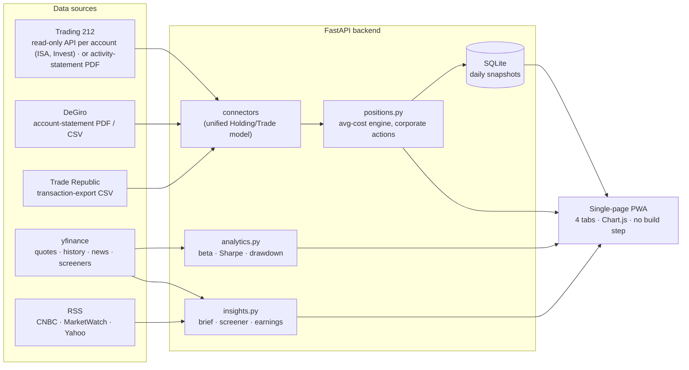

# 📈 Stock Overview


A self-hosted, mobile-first dashboard that **unifies your stock portfolio across
multiple brokers** — Trading 212 (Invest and Stocks ISA), DeGiro and Trade
Republic — into one live app: merged positions, exact profit accounting, a UK
tax-year view, quant analytics, a daily market brief, and a transparent
small-cap screener. Shows amounts in pounds or euros.

**Read-only by design: it can never place a trade or move money.**

## ⚡ Try it in 60 seconds (demo mode)

```bash
git clone https://github.com/GidonPeeper/stock-overview.git && cd stock-overview
python3 -m venv .venv && .venv/bin/pip install -r requirements.txt
.venv/bin/uvicorn backend.main:app
# → open http://127.0.0.1:8000  — bundled sample data, no keys needed
```

## ✨ Features

| | |
|---|---|
| 🔀 **Merged holdings** | The same company held at several brokers or accounts becomes one position (matched by ISIN) |
| 🇬🇧 **UK tax year** | Gains and dividends outside your ISA since 6 April, CGT and dividend allowance left, ISA allowance used, and a 30-day ("bed and breakfast") reminder after each sale |
| 🌾 **Tax-loss harvesting** | Positions outside your ISA that are down enough to sell for a tax loss: tax saved this year (using this year's gains and the £3,000 allowance), the day you can buy back, and swaps that keep you invested (Bed & ISA, the same index from another provider, a close peer). UK by default; US and NL via `TAX_RESIDENCE` |
| 💷 **£ / €** | One tap switches every amount between pounds and euros; London prices quoted in pence are handled |
| 💶 **Exact P/L accounting** | Real per-trade FX + fees from broker statements; handles splits, delistings, ISIN changes; reconciles with each broker's own figures |
| 📊 **Live market layer** | Index ticker strip, per-holding sparklines, today's movers, tap-through detail sheet with 1D/1W/1M/1Y chart + news |
| 🧠 **Daily Brief** | A generated newsletter: your portfolio's day, risk check, and headlines interleaved from CNBC, MarketWatch & Yahoo Finance |
| 🔬 **Quant analytics** | Beta vs S&P 500, annualized volatility, Sharpe, max drawdown, concentration, currency exposure — flow-adjusted so deposits don't fake returns |
| 🌱 **Rising Stars screener** | Small-caps from Yahoo screeners, re-scored 0–100 with a fully disclosed methodology (momentum / valuation / size) — research leads, not advice |
| 📅 **Earnings calendar** | Upcoming earnings dates for everything you hold |
| 📉 **Performance since inception** | Portfolio value & profit reconstructed from full trade history, with a money-weighted S&P 500 benchmark overlay |
| 📱 **Installable PWA** | Home-screen app with login (Face ID via Keychain), auto-refresh, offline-tolerant loading |
| 🏦 **Net worth view** | Bank/cash accounts (e.g. Rabobank, Revolut) alongside investments — balances edited in-app in seconds, "where your money is" breakdown |
| ⚙️ **Self-service data** | Upload the broker's own exports (DeGiro PDF, Trade Republic CSV, Trading 212 PDF) in-app; each is converted, validated against the statement's own totals, and shown live/sample per source |

## 🏗 Architecture



## 🔑 Using your own data

Everything private is git-ignored and resolved from `data/`, the project root,
or `/etc/secrets` (Render Secret Files) — the in-app banner tells you exactly
which sources are live vs sample. Drop the files the brokers actually give you
on the **Settings page** (phone-friendly) or convert them locally:

| Broker | What to export | Local command |
|---|---|---|
| **DeGiro** | Activity → Account statement, all dates → **PDF** (or CSV) | `python -m backend.importers.degiro_pdf "Account.pdf" data/degiro_account.csv` |
| **Trade Republic** | App → Profile → Activity → **Export** (transaction CSV) | `python -m backend.importers.traderepublic_csv "Transaction export.csv"` |
| **Trading 212** | one **read-only API key pair per account** in `.env` (`cp .env.sample .env`): `T212_ISA_API_KEY/SECRET`, `T212_INVEST_API_KEY/SECRET` — or, without a key, History → **Activity statement** PDF (EU account) | `python -m backend.importers.trading212_pdf "Activity-Statement.pdf"` |

Every importer validates what it read: DeGiro fills against their booked
amounts, Trade Republic against the running cash balance, Trading 212 against
the statement's own totals (realised return, dividends, interest, deposits,
open positions). Trading 212's PDFs hide their digits behind fonts with no
text mapping; `backend/importers/text_layer.py` decodes them deterministically
from the glyph drawings (no OCR needed).

Accounts whose name contains "ISA" are treated as tax-free. Uninvested cash in
each Trading 212 account is added to your net worth automatically.

Optional settings in `.env`: `DISPLAY_CURRENCY` (`GBP`/`EUR`), `UK_RESIDENT_FROM`
(the day you became UK resident, for a split tax year), `TAX_RESIDENCE` (`UK`/`US`/`NL`)
and `CGT_RATE` for the tax-loss harvesting card, and `NEWSAPI_KEY` to
blend NewsAPI into the Daily Brief.

## ✅ Tests

```bash
.venv/bin/python -m unittest discover -s tests -t .
```

The tests use canned Trading 212 responses, so they need no keys or network.

## ☁️ Deploy

Free 24/7 hosting on Render with the repo public and your data private
(env vars + Secret Files): see [`DEPLOY_RENDER.md`](DEPLOY_RENDER.md).

## 🔒 Privacy & safety

- The repo contains **code + sample data only** — statements and keys never
  enter git in plaintext (verified: no secrets anywhere in history). The owner's
  data ships only as `data/vault.enc`: Fernet-encrypted (PBKDF2, 600k
  iterations) with a key that lives exclusively in the host's environment.
- The Trading 212 key is **read-only**: worst case is viewing, never trading.
- The dashboard sits behind a session login; iOS unlocks it with Face ID.

## 🛠 Stack

FastAPI · vanilla JS + Chart.js (no build step) · SQLite · yfinance · pdfplumber · RSS/stdlib.

## License

MIT — see [LICENSE](LICENSE).
